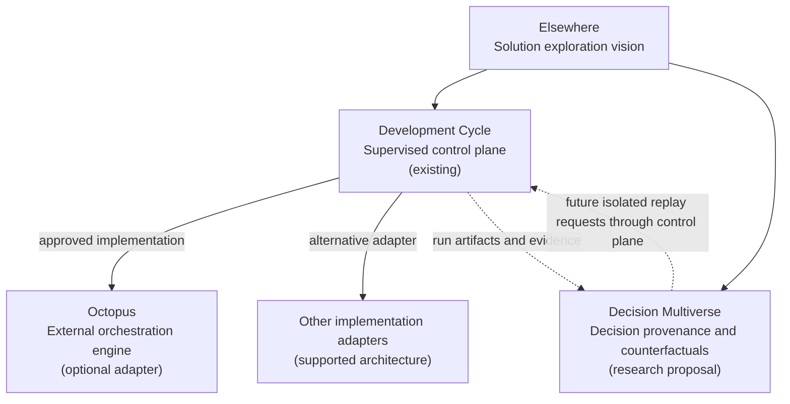

# The Roads Not Taken: Engineering in a World of AI Agents

*Working thesis / research proposal — 13 October 2026. Conceptual, not peer-reviewed; no experimental result is claimed.*

## Elsewhere — architecture and research direction

**Elsewhere — Same same, but different.** One problem. Different decisions. Different futures.

The diagram distinguishes **existing components** from a **research proposal**. Octopus is an external, optional implementation adapter, not part of Development Cycle's owned code. Decision Multiverse should initially consume completed-run evidence read-only; future replay would be mediated by Development Cycle's authorized control plane. Arrows are conceptual relationships, not claims that replay exists today. No fixed number of decision branches is imposed.

## The kitchen

I do not build software for its own sake. I build solutions. Software is often an ingredient, not the outcome. I imagine AI as an enormous kitchen: capable agents increasingly prepare the work, while the human's contribution becomes closer to that of a top chef — choosing what is worth making, setting standards, judging trade-offs, tasting the result and taking responsibility for what gets served.

The strong version of this forecast — that AI eventually handles nearly all execution — is a belief, not an established fact. Deep understanding remains necessary to direct and validate results. Delegation of coding does not imply delegation of judgment.

## A limitation of linear agentic development

Current supervised agent workflows can make execution durable, recoverable and auditable. Yet a completed run typically emphasizes the trajectory actually taken. At consequential forks, other plausible approaches are considered, rejected or never surfaced. A history of commits tells us what changed; it often does not tell us why that future was selected or what competing futures might have been.

If execution becomes cheaper, the frontier may shift from *how to implement a decision* to *which of several possible solutions should be pursued*. This claim is testable rather than self-evident. More generated branches could simply increase noise and cost.

## The Decision Multiverse hypothesis

Capture important decisions along a solution-development trajectory and show their context-specific alternatives, concise pros/cons and evidence in a navigable graph. The agent is **not** restricted to three branches, to preset categories, or even to producing any alternative when none is justified. The structure should reflect the real choice space, not a UI template.

In an initial read-only phase, the map is a provenance-aware interpretation of a completed run. Some decisions have explicit justifications; others have only observable artifacts; some are unknowable. These must be labeled differently. An unexecuted branch has a hypothesis, not an observed outcome.

A later phase would let a human select a historical fork, reconstruct a suitable checkpoint, and execute another path in isolation. Only then can we compare the *actual* resulting artifacts, behavior, cost and product outcome under comparable criteria. A parallel search over many forks is a long-term research direction, not a current capability.

## Related practice

Several existing practices cover parts of this idea. Architecture decision records capture a human-written decision, its context and the alternatives considered. Best-of-N sampling and parallel agent attempts generate several complete solutions and pick one. Tree-of-thought style search explores branches inside a single reasoning episode.

The proposal differs in where it forks and what it records: it branches at a consequential decision inside a supervised run rather than resampling the whole run, and every displayed alternative carries provenance (observed, agent-stated or inferred). Whether that distinction yields better solutions than best-of-N at equal cost is exactly question 6 below.

## What must be proven

1. **Discovery:** can the system distinguish consequential decisions from routine actions without swamping the human in noise?
2. **Provenance:** can it faithfully report observed choice and evidence without inventing private reasoning or retrospective rationales?
3. **Counterfactual validity:** can another branch be evaluated without leaking hindsight from the chosen branch?
4. **Reproducibility:** can a stateful development task be replayed sufficiently well to support meaningful comparisons?
5. **Quality:** does deliberate fork exploration improve *real solution quality*, not just code volume or superficial benchmark scores?
6. **Efficiency:** does it outperform simply granting an agent more execution budget on a single trajectory?
7. **Human role:** which choices benefit from expert taste and domain context, and when does human intervention make results worse?
8. **Generality:** do any gains transfer from code-centric workflows to product choices and other solution domains?

## Minimal research protocol

First establish a stable linear baseline on a fixed synthetic task (see the roadmap's Phase 0). Then take one completed run of that task and document a small number of material decisions. Define independent behavioral acceptance criteria before any replay. Compare linear execution, human-directed selection and constrained multi-branch exploration using comparable context and budgets. Record interventions, total cost, duration, functional results and downstream usability. This first study tests feasibility, not general superiority; larger replicated tasks would be required for robust conclusions.

## Risks and possible falsifications

Post-hoc explanations can be convincing but false. Executions may not be reproducible. A branching graph can explode combinatorially, confuse users, or encourage optimization for poor graders. Most forks may be uninteresting. If exploration does not improve the quality/cost frontier, the central product hypothesis should be revised, even if the visualization is attractive.

## Closing question

*If AI makes execution abundant, does the next frontier of engineering become the exploration of possible solutions rather than the implementation of one chosen path?*

This is a research question. The next step is to build a small observability instrument and test it, not to claim the answer.
